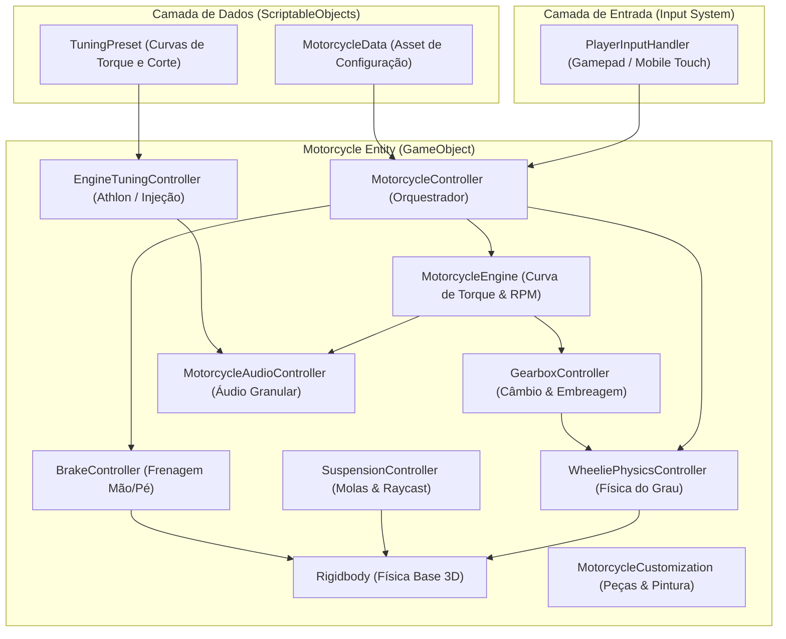

# Arquitetura Técnica da Nova Implementação (Clean-Room): Unity 6 & C#

> [!IMPORTANT]
> Proposta de arquitetura de software modular, extensível e 100% independente para o desenvolvimento do novo jogo em Unity 6. Esta especificação segue os padrões de engenharia *Clean Architecture* e *Domain-Driven Design* (DDD), não utilizando código proprietário do jogo original.

---

## 1. Visão Geral dos Módulos e Responsabilidades

A física e o comportamento das motocicletas serão divididos em controladores desacoplados, onde cada componente possui uma responsabilidade única (*Single Responsibility Principle*):



---

## 2. Especificação dos Controladores Modulares

### 2.1 `MotorcycleController` (Orquestrador Central)
* **Responsabilidade**: Ponto de entrada do veículo que recebe os comandos do piloto e distribui entre os subsistemas.
* **Ciclo de Vida**:
  * Executa a inicialização a partir do asset `MotorcycleData`.
  * Em `FixedUpdate`, coordena a ordem de execução física para manter estabilidade numérica.

### 2.2 `WheeliePhysicsController` (Controlador do Grau)
* **Responsabilidade**: Implementar a física diferencial de inclinação de arfagem (*pitch*), ponto de equilíbrio e estabilização.
* **Modelo Físico**:
  * Aplica torques com `Rigidbody.AddRelativeTorque(Vector3.right * torqueCalculado, ForceMode.Acceleration)`.
  * Calcula as forças restauradoras de gravidade e corte de assistência angular conforme detalhado em [FORMULAS_FISICA_MOTOS.md](file:///C:/Users/washi/.gemini/antigravity/brain/878b361f-e377-4953-97fd-38f436efc1de/FORMULAS_FISICA_MOTOS.md).
  * Gerencia o contra-esterço dinâmico nos eixos Y e Z locais.

### 2.3 `MotorcycleEngine` (Motor e Tração)
* **Responsabilidade**: Simular o virabrequim, rotação ($RPM$), inércia do volante do motor e torque transmitido.
* **Comportamento**:
  * Avalia a curva de torque via `AnimationCurve` nativa do Unity.
  * Respeita os cortes comandados pelo `EngineTuningController`.

### 2.4 `GearboxController` (Câmbio e Transmissão)
* **Responsabilidade**: Gerenciar relações de marcha ($G_1, G_2, \dots, G_6$), relação final da coroa/pinhão e estado da embreagem.
* **Modos**:
  * Modo Automático: Troca de marchas otimizada pelo ponto de potência máxima.
  * Modo Manual (Sequencial): Botões dedicados de marcha para cima/baixo na HUD.

### 2.5 `BrakeController` (Sistema de Frenagem Duplo)
* **Responsabilidade**: Tratar independentemente os comandos do manete dianteiro e do pedal de freio traseiro.
* **Comportamento**:
  * O freio traseiro envia sinal proporcional ao `WheeliePhysicsController` para controle de atitude no ar.

### 2.6 `SuspensionController` (Suspensão e Geometria)
* **Responsabilidade**: Suportar tanto `WheelCollider` padrão quanto um sistema customizado baseado em *Raycast Suspension*.
* **Comportamento**:
  * Permite regular curso, dureza e altura em tempo de execução via interface da oficina.

### 2.7 `EngineTuningController` (Injeção Eletrônica / ECU)
* **Responsabilidade**: Emular o comportamento de centelha e combustível.
* **Funcionalidades**:
  * Corte de giro em limite configurável.
  * Modo *Two-Step* ativado com moto parada.
  * Emissão de eventos para estampidos e labaredas no escapamento.

### 2.8 `MotorcycleAudioController` (Síntese e Amostragem Sonora)
* **Responsabilidade**: Misturar loops de aceleração, marcha lenta, desaceleração e efeitos especiais.
* **Comportamento**:
  * Modula dinamicamente o *Pitch* de um `AudioSource` de acordo com o $RPM$.
  * Dispara amostras pontuais (*one-shots*) de alta fidelidade nos eventos de corte.

---

## 3. Estrutura de Dados com `ScriptableObjects`

Para garantir que novos modelos de motocicletas e peças sejam criados sem necessidade de recompilar código:

```csharp
[CreateAssetMenu(fileName = "NewMotorcycleData", menuName = "Moto/Motorcycle Data")]
public class MotorcycleData : ScriptableObject
{
    [Header("Identificação")]
    public string motorcycleName;
    public string category;
    public float basePrice;

    [Header("Física do Chassi")]
    public float totalMass = 120f;
    public Vector3 centerOfMassOffset = new Vector3(0, -0.2f, 0);

    [Header("Parâmetros do Grau")]
    [Range(40f, 75f)] public float balanceAngle = 60f;
    [Range(75f, 90f)] public float crashAngle = 82f;
    public float liftTorque = 350f;
    public float brakeTorque = 400f;
    public float recoverySpeed = 5f;

    [Header("Motor e Transmissão")]
    public float idleRpm = 1200f;
    public float maxRpm = 10500f;
    public AnimationCurve torqueCurve;
    public float[] gearRatios = new float[] { 3.0f, 2.1f, 1.6f, 1.3f, 1.0f };
    public float finalDriveRatio = 3.2f;
}
```

---

## 4. Desacoplamento entre Física, Animação e Interface

* **Padrão de Eventos (C# Actions / UnityEvents)**:
  * O controlador físico nunca referencia classes de UI diretamente.
  * A física emite eventos como `OnRpmChanged(float rpm)`, `OnWheelieStateChanged(float currentAngle, bool inBalance)` e `OnGearShifted(int newGear)`.
  * Componentes visuais (`HUDController`, `RiderIKAnimator`) assinam esses eventos e atualizam ponteiros, velocímetros e rotação de ossos de forma reativa.
