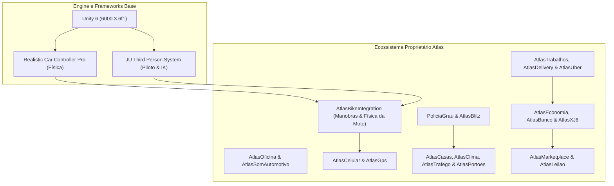
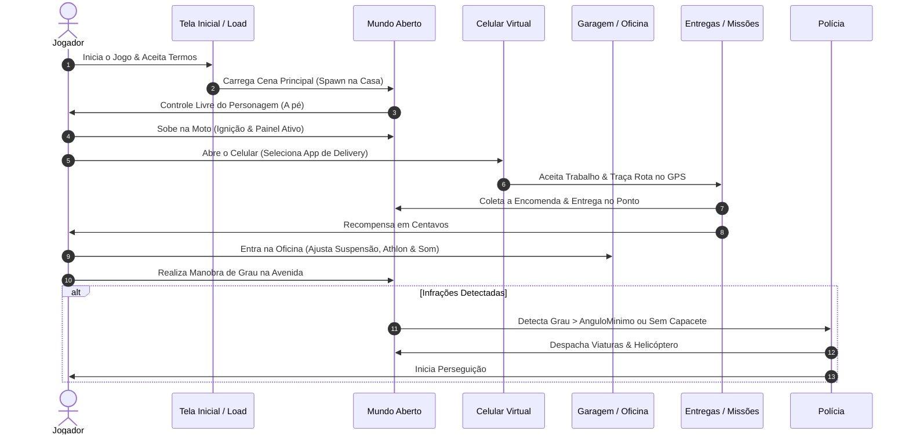
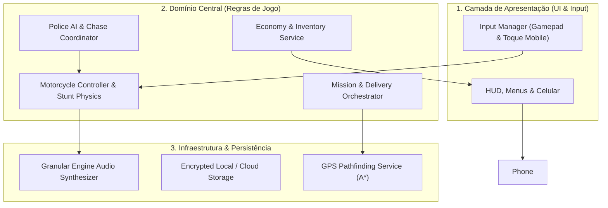

# Especificação Técnica e Arquitetura Funcional: Projeto Grau 2

> [!IMPORTANT]
> Este documento consolida a engenharia reversa estática e nativa realizada sobre o pacote oficial **`com.InsanityGroup.ProjetoGrau2`** (Unity 6 / IL2CPP v39, arquitetura ARM64), combinando a análise dos metadados (`global-metadata.dat`), do binário nativo (`libil2cpp.so`, 104,38 MB) e dos pacotes de recursos (`datapack.unity3d`, 649,63 MB) extraídos legitimamente do dispositivo móvel.

---

## 1. Identificação Oficial do Pacote e Arquivos Extraídos

* **Pacote**: `com.InsanityGroup.ProjetoGrau2`
* **Versão**: `1.0.13` (Unity Engine `6000.3.6f1`)
* **Arquivos APK Extraídos (`REA\extracted_apks\`)**:
  * `base.apk` (24,19 MB) — SHA-256: `87406CA9BCCE0E46DF419B129602BB0964872AADB312377C477A02A5C6F18BE1`
  * `split_config.arm64_v8a.apk` (39,89 MB) — SHA-256: `99CCDC38038C00B6484A8A8D134EFB8F9A249ECCC5F791A03339D459500F2D07`
  * `split_UnityDataAssetPack.apk` (719,26 MB) — SHA-256: `11C154B3153FF0C085625F7A95C5F1A1CFEEE17868A7DB640135B36BE7B3426B`
  * `split_config.xxhdpi.apk` (130,58 KB) — SHA-256: `C0F0FFD002D86F43A13D028F406AE632B869F31CD674DC5F62166323ECF52EE0`
* **Arquivos Críticos Descompactados**:
  * `libil2cpp.so` (104,38 MB) — `REA\extracted_apks\native_libs\libil2cpp.so`
  * `datapack.unity3d` (649,63 MB) — `REA\extracted_apks\unity_datapack\datapack.unity3d`
  * `global-metadata.dat` (14,98 MB) — `REA\extracted_apks\base_assets\Managed\Metadata\global-metadata.dat`

O jogo foi estruturado sob o ecossistema proprietário **`Atlas*`** (composto por mais de 974 classes identificadas), acoplado a dois frameworks consolidados no mercado: **RCCP** (*Realistic Car Controller Pro*) para a física veicular de base e **JUTPS** (*JU Third Person System*) para o controle cinemático do piloto e IK.

---

### 1.1 Menu Inicial, Inicialização e Termos
* **Namespace**: `AtlasInicio`
* **Classes**: `TelaInicial`, `VisualDeCarregamento`, `MusicaDoCarregamento`, `DetectorDeDns`
* **Mecânicas**:
  * Exibição de termos de uso e aviso de ficção jurídica (`VersaoDosTermos`, `VersaoDoAvisoDeFiccao`, `Aceitar()`).
  * Música de carregamento com fade in/out suave (`MusicaDoCarregamento`).
  * `DetectorDeDns`: verifica resoluções de nomes contra servidores AdGuard e bloqueadores para alertar ou adaptar a rotina de anúncios.

---

### 1.2 Personagem, Roupas e Customização
* **Namespace**: `AtlasPersonagem` (56 classes)
* **Classes**: `AcessoriosDoBase`, `VestirAcessoriosDoBase`, `Balaclava`, `Chinelos`, `Bone`, `Capacete`, `Tatuagem`, `Oculos`, `Mascara`
* **Mecânicas**:
  * Modularidade de malhas: troca dinâmica de cabeças, cabelos, calçados e vestimentas acopladas ao rig do personagem.
  * Acessório especial `Balaclava`: possui botão rápido na HUD para colocar/tirar, com limite de velocidade na moto (`k_VelocidadeMaximaNaMoto`).
  * Sistema de bolsa de entrega: modelo 3D de bag nas costas acoplado dinamicamente ao tronco (`AjustarAoTronco()`).

---

### 1.3 Garagem, Catálogo e Oficinas
* **Namespaces**: `AtlasOficina`, `AtlasSomAutomotivo`, `AtlasLavaRapido`, `AtlasRodas`
* **Classes**: `OficinaCanvas`, `AjusteDoSom`, `AltoFalante`, `BibliotecaDeMusicas`, `LavaRapido`
* **Mecânicas**:
  * **Customização Estética**: troca de carenagens, rabeta, pintura (RGB + metálico/suavidade), escapamentos, retrovisores e remoção de placa.
  * **Customização Sonora (Paredão de Som)**:
    * Emulação física de alto-falantes automotivos nos veículos (`AltoFalante`). Os cones sofrem excursão real em milímetros (`m_Curso`, `Tremida`) sincronizada com o grave da música.
    * Equalizador de som: ajustes em tempo real de graves, agudos e volume geral (`AjusteDoSom`).
    * Leitor de músicas locais: leitor integrado que permite carregar arquivos de áudio do armazenamento do usuário (`BibliotecaDeMusicas.Importar()`).
  * **Lava Rápido**: sistema de acúmulo de sujeira na moto por tempo de rodagem, com remoção mediante pagamento no lava rápido.

---

### 1.4 Mecânica Avançada da Moto, Manobras e Física (O "Grau")
* **Namespace**: `AtlasBikeIntegration`
* **Classes Chave**:
  * `BikeWheelie`: núcleo do torque vertical, ponto de equilíbrio (`balanceAngle`), zona de perda de controle (`noTurnAngle`), e ângulo fatal de capotamento (`crashAngle`).
  * `TempoDeGrau`: cronometragem precisa do tempo contínuo de equilíbrio sobre uma roda, registrando recordes pessoais salvos na conta do jogador.
  * `GasEFreio`: controle independente do manete de aceleração, freio dianteiro na mão e freio traseiro no pedal (fundamental para não virar de costas).
  * `Athlon` (`ModuloAthlon`, `ConfigDoAthlon`, `EscapeDoAthlon`): simulação de injeção programável brasileira. Ajuste de rotação máxima, histerese do corte de giro, *Two-Step* (controle de largada), estampidos no escapamento (*backfire / pops & bangs*) e chamas visuais com iluminação pontual.
  * `Molejo`: controle de pressão, constante de mola e amortecimento dianteiro/traseiro.
  * `DinamometroDaMoto`: rolo de medição de curvas de potência (CV) e torque (Nm), permitindo testes de *Remap*.
  * `EfeitosDaRaspada` e `PlacaDoParaBarro`: quando o ângulo ultrapassa o equilíbrio e atinge a traseira, há geração de faíscas e partículas. Se a raspagem persistir, a placa sofre danos (`vidaDaPlacaCaida`) e se desprende da moto rolando pela pista.

---

### 1.5 Sistema de Manobras Acrobáticas
* **Classes**: `CatalogoDeManobras`, `ManobrasDaMoto`, `MaoNaManoplaNaManobra`
* **Mecânicas**:
  * **Transições Posturais**: manobras clássicas como *Abrir o Tanque* (sentar no guidão com pernas abertas), *Cruzar a Perna* no banco e apoios na pedaleira traseira.
  * **Inverse Kinematics (IK)**: o script `MaoNaManoplaNaManobra` recalcula as cadeias cinemáticas dos braços (`DobrarOTronco`, `LevarOCorpo`) para que o avatar não perca o contato natural com o guidão durante as movimentações extremas.

---

### 1.6 Sistema Policial, Perseguição e Blitz
* **Namespaces**: `PoliciaGrau`, `AtlasBlitz`
* **Classes**: `PoliciaGrau.ControleDaViatura`, `JUPoliceAIController`, `JUPoliceSpawnManager`, `Captura`, `HelicopteroDaPolicia`, `Infracoes`, `BloqueioNaFuga`
* **Mecânicas**:
  * **Detecção de Infrações**: o script `Infracoes` monitora se o jogador está sem capacete (`TemCapacete`) ou empinando em via pública (`AnguloDeGrau`), acionando o estado de procurado.
  * **Táticas de Perseguição**:
    * Viaturas utilizam IA preditiva de trânsito (`MotoristaDaViatura`), com tempos de resposta, ultrapassagens e aproximação de contato ("colando").
    * Motocicletas policiais (`MotoDaPolicia`): mais ágeis, com piloto que pode sacar cacetete para derrubar o fugitivo (`AtaqueDaMotoPolicial`).
    * Bloqueios táticos na pista (`BloqueioNaFuga`) e suporte aéreo com holofote e perseguição visual (`HelicopteroDaPolicia`).
  * **Prisão e Apreensão**: raio de captura (`RaioDeCaptura`) e cronômetro de detenção. Ao ser preso, o jogador perde a moto temporariamente (enviada ao pátio) e cumpre animação na delegacia (`AnimacoesDaPrisao`).

---

### 1.7 Economia, Compras, Marketplace e Leilão
* **Namespaces**: `AtlasEconomia`, `AtlasBanco`, `AtlasMarketplace`, `AtlasLeilao`, `AtlasXJ6`
* **Classes**: `DinheiroSujo`, `AppLeilao`, `Anuncio`, `AvaliacaoDoLeilao`, `CargaDoLeilao`
* **Mecânicas**:
  * **Moeda em Centavos**: cálculo em inteiros para precisão monetária.
  * **Dinheiro Legal vs. Dinheiro Sujo**: saldo obtido em trabalhos comuns vs. quantias obtidas em atividades ilícitas ou missões especiais.
  * **Marketplace**: classificados virtuais para compra e venda de veículos com geração procedural de defeitos (`Defeitos`, `FaseDoAnuncio`).
  * **Leilão de Pátio**: motos apreendidas vendidas em lotes. O jogador avalia o estado mecânico (`k_Fumacando`, `k_NaoLiga`, `RetificaDaTabela`) e utiliza uma carretinha com rampa (`CargaDoLeilao`) para transportar a moto danificada até sua oficina.

---

### 1.8 Celular, GPS e Navegação
* **Namespaces**: `AtlasCelular`, `AtlasGps`, `AtlasFoto`
* **Classes**: `CelularCanvas`, `AppMolejo`, `AppGasEFreio`, `AppAthlon`, `GpsDoMapa`, `RedeDeRuas`, `CameraDrone`
* **Mecânicas**:
  * Smartphone completo com interface simulada (apps instaláveis, notificações e papéis de parede).
  * **GPS A\***: malha viária topológica (`RedeDeRuas`, `WaypointsLigados`) que calcula rotas com tolerância à contramão e guia o minimapa por meio de uma linha de rota procedural (`LinhaDaRota`).
  * **Modo Drone/Foto**: câmera orbital livre com ajuste de zoom, profundidade e opção de congelamento temporal do cenário para captura de fotos.

---

### 1.9 Mundo Aberto, Casas e Tráfego
* **Namespaces**: `AtlasCasas`, `AtlasClima`, `AtlasTrafego`, `AtlasReboque`, `AtlasPortoes`
* **Classes**: `CasasDoJogador`, `CenaDaMansao`, `ConfiguracaoClima`, `LuzesDoTrafego`, `DesengarrafarTrafego`, `CarretinhaGta`, `CancelaAutomatica`
* **Mecânicas**:
  * **Sistema Imobiliário**: compra de mansão com garagem própria e definição de ponto de spawn.
  * **Ciclo Climático**: ciclo dia/noite com suporte a chuva e acendimento automático de luzes nas janelas dos edifícios à noite (`JanelasNoturnas`).
  * **Gestão de Tráfego Leve**: controle de spawn de carros civis com remoção inteligente de veículos distantes ou engarrafados para poupar memória mobile (`DesengarrafarTrafego`).
  * **Reboques e Portões**: carretinhas físicas com física de engate articulado e portões residenciais automáticos ativados por proximidade.

---

## 2. Documentação da Experiência do Jogador (Game Loop)

---

## 3. Inventário de Recursos Visuais e Sonoros

Para a reconstrução ou substituição de recursos na nova implementação, estes são os componentes originais, formatos e requisitos técnicos:

| Categoria | Formatos Típicos na Unity | Localização no APK / Pacote | Papel no Jogo |
| :--- | :--- | :--- | :--- |
| **Modelos de Motos** | `.mesh`, `.fbx` (estruturados em Prefabs) | `assets/bin/Data/` ou `.bundle` | Modelos detalhados separados por peças (chassi, rodas, garfo, guidão, placa, escapamento). |
| **Personagens e Roupas** | Malhas *Skinned* com rig Humanoid | `assets/bin/Data/` | Corpos base com skins removíveis (bermudas, camisas, capacetes, balaclava). |
| **Cenário Urbano** | Malhas modulares com colisores convexos | Cenas serializadas (`level0`, etc.) | Pistas de asfalto, calçadas, oficinas, casas, delegacia e pátio. |
| **Áudio dos Motores** | Arquivos WAV/OGG em loop | `assets/` | Amostras granulares de aceleração, corte de giro, marcha lenta e *backfire*. |
| **Músicas e Rádio** | MP3/OGG estéreo | `assets/` ou streaming externo | Faixas para o sistema de som automotivo e menu inicial. |
| **Interface Gráfica** | Sprites atlas PNG/SVG | Texturas de UI nos AssetBundles | Ícones de botões táteis, aplicativos do celular e placares de grau. |

---

## 4. Arquitetura Modular Recomendada para a Futura Implementação

A fim de criar um projeto moderno, escalável e livre de códigos proprietários de terceiros, recomenda-se uma arquitetura baseada em **Domain-Driven Design (DDD)** e desacoplada por eventos:

### Princípios da Nova Arquitetura
1. **Desacoplamento de Física e Visual**: A física de manobras de grau (`WheeliePhysicsComponent`) deve operar estritamente via forças e torques físicos (`Rigidbody.AddTorque`), enquanto animações e Inverse Kinematics dos braços adaptam-se aos ângulos resultantes.
2. **Sistema de Injeção Eletrônica Parametrizável**: Uma classe `EngineTuningConfig` em formato *ScriptableObject* contendo curvas de torque, RPM de corte e parâmetros de *two-step*, permitindo trocar o comportamento da moto sem reescrever lógica.
3. **Gerenciador de Aplicativos Plugável**: O celular virtual deve atuar como uma casca (*Shell*), onde cada novo aplicativo é um módulo independente que implementa uma interface padrão (`IPhoneApp`).
4. **Economia Baseada em Eventos**: O saldo nunca é alterado diretamente pelas telas, mas sim por transações registradas (`EconomyService.ProcessTransaction`), mantendo integridade e facilitando auditoria contra manipulações.
