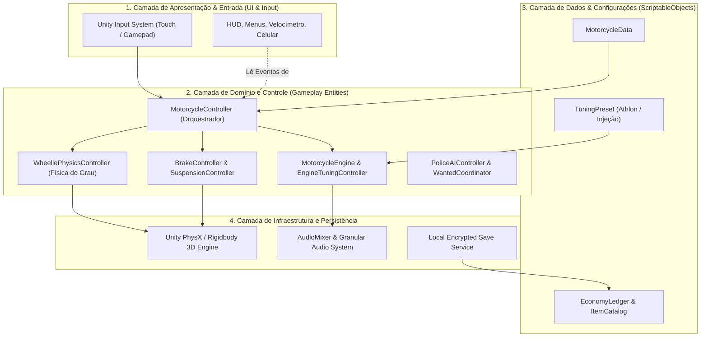

# ARQUITETURA GLOBAL DO SISTEMA (SYSTEM ARCHITECTURE)

## 1. Visão em Camadas (Layered Architecture)

A nova implementação do Projeto Grau 2 adota o modelo de quatro camadas desacopladas:

## 2. Padrões Arquiteturais Adotados
* **Inversão de Dependência (IoC)**: Os controladores físicos dependem de abstrações e dados injetados via `ScriptableObjects`, nunca de valores literais em código.
* **Barramento Reativo de Eventos**: Nenhuma tela de interface ou som consulta a física em polling contínuo. As informações são propagadas via eventos quando os valores sofrem mutação.
