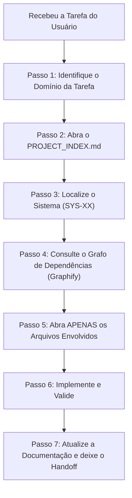

# GUIA INICIAL DO AGENTE (AGENT START HERE)

> [!IMPORTANT]
> **ATENÇÃO AGENTE DE IA**:  
> Você acabou de entrar no projeto **Projeto Grau 2**.  
> **NÃO comece a ler indiscriminadamente todos os arquivos do projeto.**  
> O consumo excessivo de contexto atrasa a resposta, consome tokens desnecessários e introduz ruído.  
> Siga rigorosamente este guia passo a passo.

---

## 1. Regra de Ouro: Economia de Contexto e Foco Cirúrgico

1. **Nunca leia a pasta inteira**: O projeto possui centenas de arquivos, especificações e relatórios de engenharia reversa. Você deve acessar **apenas** o que for estritamente relevante para a tarefa solicitada.
2. **O Ponto de Entrada é Único**: Sempre comece consultando o arquivo mestre:
   👉 [[PROJECT_INDEX]]
3. **Siga o Protocolo de Recuperação Seletiva**:
   👉 [[CONTEXT_RETRIEVAL_PROTOCOL]]

---

## 2. Seu Roteiro de Ação em 5 Minutos

1. **Passo 1: Entenda a Demanda**:
   - Exemplo: *"Quero alterar a rigidez da suspensão traseira da moto."*
   - Domínio: **Suspensão** (`SYS-04: Suspensão (Molejo)`).
2. **Passo 2: Vá ao [[PROJECT_INDEX]]**:
   - Procure a linha `SYS-04` na tabela de sistemas.
   - Veja o link para a documentação: `[[SYS_SUSPENSION]]`.
   - Veja o status atual e as dependências listadas: `Rigidbody`, `WheelCollider / Raycast`.
3. **Passo 3: Consulte o Mapa de Relacionamentos**:
   - Verifique em `[[RELATIONSHIP_INDEX]]` quais outros módulos dependem de `SYS-04`.
   - Verá que o sistema de empinar (`SYS-01: Wheelie`) é impactado pela suspensão traseira.
4. **Passo 4: Abra Apenas os Documentos Necessários**:
   - Abra `[[SYS_SUSPENSION]]` e `[[FORMULAS_FISICA_MOTOS]]` (seção de suspensão).
   - **NÃO** abra documentos de polícia, missões, economia, UI ou áudio.
5. **Passo 5: Execute o Trabalho e Conclua com o Handoff**:
   - Aplique os padrões de código definidos em [[CODING_STANDARDS]].
   - Atualize a documentação do sistema conforme [[DOCUMENTATION_RULES]].
   - Escreva o resumo de fechamento da sessão seguindo [[HANDOFF_PROTOCOL]].

---

## 3. Links Rápidos de Referência

* **Índice Mestre**: [[PROJECT_INDEX]]
* **Protocolo de Recuperação de Contexto**: [[CONTEXT_RETRIEVAL_PROTOCOL]]
* **Padrões de Engenharia C# / Unity 6**: [[CODING_STANDARDS]]
* **Regras de Documentação Técnica**: [[DOCUMENTATION_RULES]]
* **Protocolo de Passagem de Turno (Handoff)**: [[HANDOFF_PROTOCOL]]
* **Índice de Relacionamentos (Graphify)**: [[RELATIONSHIP_INDEX]]
