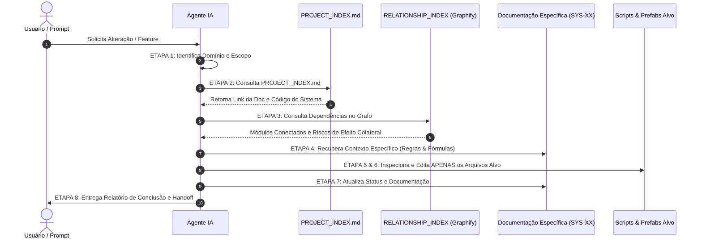

# PROTOCOLO OBRIGATÓRIO DE RECUPERAÇÃO SELETIVA DE CONTEXTO
> **Nenhum agente de IA deverá ler indiscriminadamente todos os arquivos do projeto antes de começar uma tarefa.**  
> A leitura global só é admitida em auditorias ou refatorações transversais justificadas.

---

## O Fluxo Operacional Obrigatório em 8 Etapas

---

### ETAPA 1 — IDENTIFICAR A TAREFA
* Entender o que exatamente foi solicitado pelo usuário.
* Identificar formalmente:
  * **Sistema Primário**: (Ex: `SYS-01: Wheelie`, `SYS-02: Engine`, `SYS-05: Brakes`).
  * **Subsistema / Componente**: (Ex: curva de torque, freio a pé, ponto de equilíbrio).
  * **Natureza da Ação**: Especificação, correção de bug, ajuste de parâmetro ou implementação de nova classe.

### ETAPA 2 — CONSULTAR O ÍNDICE CENTRAL
* Ler exclusivamente [[PROJECT_INDEX]] (e [[AGENT_START_HERE]], caso seja a primeira vez no projeto).
* Localizar o código `SYS-XX` na tabela de sistemas e clicar no link correspondente.

### ETAPA 3 — ANALISAR DEPENDÊNCIAS E RELACIONAMENTOS (GRAPHIFY)
* Consultar [[RELATIONSHIP_INDEX]] ou o grafo do Graphify.
* Responder obrigatoriamente a duas perguntas antes de encostar no código:
  1. *Quais módulos alimentam este componente?*
  2. *Quais outros módulos sofrerão impacto se este componente for alterado?*

### ETAPA 4 — RECUPERAR O CONTEXTO SELETIVO
* Abrir **apenas**:
  * O documento específico do sistema (ex: `02_SYSTEMS/SUSPENSION/SYS_SUSPENSION.md`).
  * As decisões arquiteturais vinculadas (ex: `06_DECISIONS/ADR/ADR_002_CLEAN_ARCHITECTURE_PHYSICS.md`).
  * A referência técnica matemática associada (ex: `03_TECHNICAL_REFERENCE/PHYSICS_FORMULAS/FORMULAS_FISICA_MOTOS.md`).
* **Bloqueio Explícito**: É proibido abrir arquivos de áudio, HUD, celular, tráfego ou polícia quando a tarefa for de física de suspensão.

### ETAPA 5 — IDENTIFICAR OS ARQUIVOS DE CÓDIGO
* Mapear com precisão cirúrgica:
  * O script C# que implementa a funcionalidade.
  * O ScriptableObject que armazena os dados.
  * O Prefab onde o componente reside na cena de teste.

### ETAPA 6 — IMPLEMENTAÇÃO
* Trabalhar exclusivamente nos arquivos identificados.
* Respeitar os padrões de arquitetura (Clean Architecture, Rigidbody, desacoplamento por eventos) definidos em [[CODING_STANDARDS]].

### ETAPA 7 — ATUALIZAR O CONHECIMENTO
* Imediatamente após a alteração no código ou parâmetros:
  * Atualizar o arquivo de documentação do sistema `SYS-XX`.
  * Se o status do sistema mudou (ex: de `ESPECIFICADO` para `EM_DESENVOLVIMENTO` ou `TESTADO`), atualizar a tabela no [[PROJECT_INDEX]].
  * Registrar a mudança no `08_CHANGELOG/CHANGELOG.md`.

### ETAPA 8 — PREPARAR CONTINUIDADE (HANDOFF)
* Registrar na mensagem final ou em `09_AGENT_CONTEXT/HANDOFF_PROTOCOL.md` o resumo da sessão para que o próximo agente retome o trabalho sem atrito.
