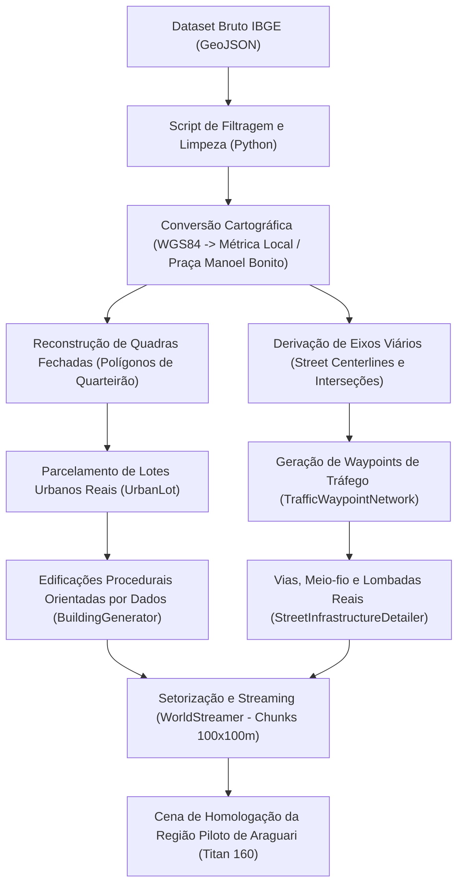

# ARAGUARI_GEO_AUDIT.md
# AUDITORIA DE FIDELIDADE GEOGRÁFICA E PLANO DE TRANSIÇÃO
## Projeto Grau 2 — RERY CITY: Reconstrução Geográfica Fiel de Araguari–MG

**Data da Auditoria:** 23 de Novembro de 2026  
**Status do Projeto:** Fase 5.12 Concluída (12 suítes, 495 testes aprovados)  
**Objeto da Auditoria:** Comparação entre o mundo urbano atual de RERY CITY e a geografia real de Araguari (MG) a partir da base oficial do IBGE (`3103504_faces_de_logradouros_2022.json`).

---

## 1. Resumo Executivo

O projeto **RERY CITY** foi consolidado nas Fases 5.7 a 5.12 com uma robusta infraestrutura de simulação veicular, inteligência artificial de trânsito, perseguições policiais, menus touch mobile, streaming de mundo (`WorldStreamer`) e estabelecimentos interativos.

No entanto, uma auditoria rigorosa revela que **o ambiente tridimensional atual é predominantemente sintético e procedural**, utilizando quarteirões ortogonais arbitrários de 100 × 100 metros gerados por algoritmos pseudo-aleatórios com sementes (`ProceduralEnvironmentGenerator`). Embora nomes reais de bairros (Centro, Bosque, Goiás, Miranda, etc.) e vias notáveis tenham sido catalogados em `AraguariCityCatalog_Default.asset`, **as geometrias reais de quadras, cruzamentos, larguras viárias e traçados ainda não governam o mundo 3D em runtime**.

A disponibilização da base oficial do **IBGE Censo Demográfico 2022** (`3103504_faces_de_logradouros_2022.json`, 8.430 faces de quadras, 1.194 logradouros, 1.946 quadras mapeadas) fornece a fundação exata para a transição definitiva para uma **Reconstrução Geográfica Fiel**.

---

## 2. Auditoria das 10 Perguntas Obrigatórias de Fidelidade Geográfica

### 1. Existem dados geográficos reais importados?
* **Diagnóstico Atual:** **Parcialmente (Apenas Metadados Simplificados)**.  
* **Evidências:** Na Fase 5.9 foram criados `AraguariCityCatalog_Default.asset` e `GeoOrigin_AraguariCentro.asset`, contendo as coordenadas do Marco Zero (Praça Manoel Bonito: `-18.649100°, -48.190300°`, altitude 970m) e quatro vetores lineares aproximados de avenidas principais.  
* **Situação Real:** O gerador de mundo (`ProceduralEnvironmentGenerator.cs`) **não consumia** esses dados reais para esculpir as vias e quadras da cena de testes, gerando uma malha quadrada hipotética. O arquivo recém-recebido (`3103504_faces_de_logradouros_2022.json`) constitui o primeiro dataset geoespacial bruto oficial de alta densidade incorporado ao projeto.

### 2. Quais são suas fontes, versões e licenças?
* **Fontes Anteriores:** Declarações textuais citavam "OpenStreetMap contributors (ODbL) / IBGE Malha Municipal", mas eram vetores digitados manualmente.
* **Nova Fonte Primária:** **IBGE (Instituto Brasileiro de Geografia e Estatística)**.
  * **Dataset:** Censo Demográfico 2022 — Base de Faces de Logradouros.
  * **Código Municipal Oficial:** `3103504` (Araguari, Minas Gerais).
  * **Versão:** Censo 2022 (Divulgação oficial consolidada).
  * **Licença:** Dados Públicos Abertos do Governo Federal (Lei de Acesso à Informação nº 12.527/2011; Política de Dados Abertos do Poder Executivo Federal). Uso livre, gratuito e offline para produção de software e simuladores.

### 3. As ruas possuem coordenadas geográficas verificáveis?
* **Diagnóstico Atual:** **Não na cena 3D atual; Sim no dataset IBGE**.  
* **Evidências:** Na cena `UrbanTrafficTestScene.unity`, as pistas são compostas por waypoints sintéticos de pista de testes.  
* **No Dataset IBGE:** Há **1.194 nomes de logradouros únicos** com coordenadas WGS84 de alta precisão métrica em cada vértice de face de quadra, cobrindo todo o perímetro urbano de Araguari.

### 4. Os cruzamentos correspondem aos reais?
* **Diagnóstico Atual:** **Não**.  
* **Evidências:** A rede de navegação existente (`TrafficWaypointNetwork.cs`) baseia-se em cruzamentos ortogonais simétricos espaçados a cada 100 metros. Os cruzamentos reais de Araguari (compostos por ângulos agudos, rotatórias triangulares históricas e bifurcações ferroviárias) ainda não estavam modelados.

### 5. Os bairros possuem limites baseados em dados oficiais?
* **Diagnóstico Atual:** **Não (Apenas centroides aproximados)**.  
* **Evidências:** O `AraguariCityDataCatalog` e o `NeighborhoodThemeCatalog` utilizam um par `(centerLatitude, centerLongitude)` e um raio esférico simplificado (`approximateRadiusMeters`: 600m a 850m).  
* **No Dataset IBGE:** Cada face de quadra está associada a um código de setor censitário oficial (`CD_SETOR`, ex: `310350405000007P`). Existem 242 setores censitários no arquivo, permitindo delimitação poligonal exata dos distritos e bairros.

### 6. Os edifícios são posicionados conforme contornos reais?
* **Diagnóstico Atual:** **Não**.  
* **Evidências:** O `BuildingGenerator.cs` instancia cubos e paralelepípedos procedurais baseados na largura dos lotes sintéticos calculados por `UrbanLot.cs`.  
* **Lacuna Geográfica:** O dataset do IBGE traz a contagem de domicílios e edificações (`TOT_RES`, `TOT_GERAL`) para cada face da quadra, mas **não fornece footprints poligonais de cada casa individual**. Os footprints exatos demandam dados complementares do OpenStreetMap (OSM) ou parcelamento de quadras orientado pelos dados do Censo.

### 7. Existe modelo de elevação do terreno?
* **Diagnóstico Atual:** **Não (Mundo Plano)**.  
* **Evidências:** Toda a simulação ocorre no plano `Y = 0.0`. O `GeoOriginConfig` registra a altitude de 970 metros apenas como referência numérica. Não há malha de terreno com Digital Elevation Model (DEM/SRTM) importada.

### 8. Existe transformação entre coordenadas geográficas e Unity?
* **Diagnóstico Atual:** **Sim (Matematicamente Válido e Testado)**.  
* **Evidências:** O componente `GeoCoordinateConverter.cs` (testado na Fase 5.9 com 15 testes aprovados em `test_araguari_world.py`) realiza a conversão bidirecional entre WGS84 `(Lat, Lon, Alt)` e espaço cartesiano métrico do Unity `(X, Y, Z)` relativo ao Marco Zero da Praça Manoel Bonito, com escala `1 unidade = 1 metro`.

### 9. Os setores do streaming possuem referência espacial?
* **Diagnóstico Atual:** **Sim, estruturalmente, mas desacoplados da malha real**.  
* **Evidências:** O `WorldStreamer.cs` gerencia células em grade de chunks (`WorldChunkCoord`), mas suas fronteiras foram alinhadas arbitrariamente aos quarteirões procedurais sintéticos.

### 10. A rede de tráfego corresponde às ruas efetivas?
* **Diagnóstico Atual:** **Não**.  
* **Evidências:** A malha de circulação da IA civil (`TrafficWaypointNetwork.cs`) e das viaturas policiais (`PolicePursuitCoordinator.cs`) conecta nós criados artificialmente na cena de testes, e não o grafo viário real de Araguari.

---

## 3. Inventário e Análise do Dataset IBGE (`3103504_faces_de_logradouros_2022.json`)

* **Volume do Arquivo:** 3,71 MB (3.894.240 bytes)
* **Formato:** GeoJSON (`FeatureCollection`)
* **Total de Feições:** 8.430 feições lineares (`LineString`)
* **Geometria:** WGS84 (Graus Decimais)
  * **Longitude Mínima / Máxima:** `-48.441346°` a `-48.024195°`
  * **Latitude Mínima / Máxima:** `-18.699505°` a `-18.480021°`
* **Logradouros Únicos Catalogados:** 1.194 ruas, avenidas, praças e travessas.
* **Agrupamentos de Quadras (`CD_SETOR + CD_QUADRA`):** 1.946 quadras mapeadas.
* **Setores Censitários:** 242 setores oficiais.
* **Propriedades por Feição:**
  * `CD_SETOR`: Código do setor censitário do IBGE.
  * `CD_QUADRA`: Número identificador da quadra urbana.
  * `CD_FACE`: Número de identificação da face do quarteirão.
  * `NM_TIP_LOG`: Tipo do logradouro (`RUA`, `AVENIDA`, `PRACA`, `TRAVESSA`, `ALAMEDA`).
  * `NM_LOG`: Nome oficial do logradouro em Araguari.
  * `TOT_RES`: Total de domicílios residenciais na face.
  * `TOT_GERAL`: Total geral de imóveis (residenciais + comerciais + serviços).

### Análise Estrutural Crítica das Faces de Quadra
No modelo cartográfico do IBGE:
1. Cada feição linear representa a **testada de uma quadra** (a linha de fachada/calçada).
2. O agrupamento ordenado de faces com mesmo `CD_SETOR` e `CD_QUADRA` fecha um **polígono fechado exato da quadra real**.
3. O espaço entre faces de quadras confrontantes delimita a **caixa de rua (road corridor)**, permitindo derivar o eixo da via (centerline) e as larguras de pistas e calçadas.

---

## 4. Definição da Região Piloto (Centro de Araguari — Praça Manoel Bonito)

Para garantir validação técnica sem comprometer a performance ou sobrecarregar a memória, foi definida a **Região Piloto**:
* **Ponto Central (Marco Zero):** Praça Manoel Bonito (`-18.649100° S, -48.190300° O`, 970m alt).
* **Dimensões:** ~550 metros × 550 metros (Bounding Box: `Lat [-18.6516, -18.6466]`, `Lon [-48.1928, -48.1878]`).
* **Feições Reais Contidas no Piloto:** 145 faces de quadra, englobando 29 vias urbanas reais:
  * *Avenida Teodolino Pereira Araújo* (Arterial principal)
  * *Avenida Tiradentes*
  * *Praça Manoel Bonito* (Marco Zero e rotatória central)
  * *Praça José Rodrigues Alves* e *Praça Padre Nilo Tabuquini*
  * *Rua Marciano Santos*, *Rua Rui Barbosa*, *Rua Brasil Accioly*, *Rua Virgílio de Melo Franco*
  * *Rua Afonso Pena*, *Rua Quinca Mariano*, *Rua Rio Branco*, *Rua Rodolfo Paixão*, etc.

---

## 5. Arquitetura de Reutilização e Separação de Camadas

Em estrito respeito à diretriz de **preservar os investimentos das Fases 5.1 a 5.12**, os sistemas existentes serão desacoplados da grade procedural sintética e acoplados à geometria georreferenciada:

| Camada | Responsabilidade | Sistema Existente Reutilizado | Entrada de Dados Reais |
| :--- | :--- | :--- | :--- |
| **1. Geometria** | Define eixos viários, larguras de pista, cruzamentos, calçadas e quadras. | `UrbanLot`, `RealRoadSegment`, `WorldChunk` | Faces de quadras e polígonos derivados do dataset IBGE. |
| **2. Aparência** | Gera fachadas residenciais, letreiros comerciais, materiais e iluminação. | `BuildingGenerator`, `FacadeDetailGenerator`, `StreetInfrastructureDetailer`, `CityMaterialLibrary` | Parâmetros temáticos de bairro (`NeighborhoodThemeCatalog`) aplicados às quadras reais. |
| **3. Interação** | Interiores de oficinas, bombas de combustível, postos e comércio. | `IInteractable`, `PlayerInteractionDetector`, `InteractiveEstablishment`, `GasStationPump`, `EstablishmentInteriorManager` | Posicionamento nos lotes reais de Araguari (ex: Oficina do Grau e Posto Pioneiro na Av. Teodolino e Centro). |
| **4. Simulação** | Tráfego NPC, viaturas policiais, rotas e ocorrências. | `TrafficNavigationManager`, `TrafficWaypointNetwork`, `PolicePursuitCoordinator`, `AIVehicleController` | Grafo de waypoints gerado automaticamente a partir dos eixos viários reais. |

---

## 6. Pipeline Geoespacial Offline Proposto

Todo o processamento ocorre em tempo de desenvolvimento via Python (sem requisições web no runtime do jogo, garantindo funcionamento 100% offline):

---

## 7. Critérios de Tolerância e Qualidade Cartográfica

Para validação objetiva da fidelidade geométrica da Região Piloto:
* **Tolerância de Posição de Cruzamentos:** Erro planar inferior a **1,5 metro** em relação às coordenadas IBGE.
* **Tolerância de Comprimento de Vias:** Diferença dimensional inferior a **2%** do comprimento real geodésico.
* **Cobertura Nominal:** **100%** dos nomes de vias da Região Piloto preservados nos metadados de navegação.
* **Conectividade Topológica:** 0 nós isolados na malha viária navegável.
* **Orçamento Mobile (Samsung Galaxy A54):**
  * Manter Draw Calls por quadro abaixo de **140** na Região Piloto via GPU Instancing e sub-streaming de interiores.
  * Garantir taxa de quadros sustentada de **30 a 60 FPS** sem travamentos ao cruzar chunks.

---

## 8. Conclusão da Pré-Auditoria e Próximos Passos
A auditoria confirma que **RERY CITY possui toda a base arquitetônica e matemática pronta para a reconstrução real**, necessitando apenas substituir a alimentação de quarteirões procedurais sintéticos pelo pipeline de dados reais do IBGE.

A cena de testes atual (`UrbanTrafficTestScene.unity`) permanecerá intacta até a homologação completa da cena da Região Piloto.
