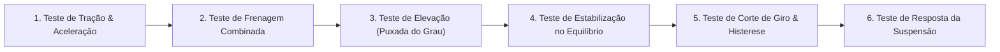

# Plano de Testes Físicos e Validação: Projeto Grau 2

> [!NOTE]
> Metodologia de testes unitários e de integração física para verificar se o modelo reimplementado reproduz com fidelidade as sensações mecânicas do jogo original.

---

## 1. Matriz de Casos de Teste Físicos

---

### Teste 1: Curva de Aceleração e Velocidade Final
* **Objetivo**: Garantir que a progressão de rotação ($RPM$) e a velocidade máxima em cada marcha correspondam às relações de transmissão.
* **Procedimento**:
  1. Posicionar a moto em pista plana sem obstáculos.
  2. Aplicar entrada de acelerador contínua ($T = 1.0$) em modo automático de marcha.
  3. Registrar a curva temporal de $RPM$ e $v$ ($km/h$) por meio de amostragem em `FixedUpdate`.
* **Critério de Aceitação**:
  * O $RPM$ deve subir suavemente de acordo com a curva de torque.
  * O tempo de 0 a 100 km/h para a classe Titan 160 deve ficar entre 11 e 13 segundos virtuais.

---

### Teste 2: Frenagem Combinada e Estabilidade Longitudinal
* **Objetivo**: Verificar a desaceleração independente com freio dianteiro vs. freio traseiro.
* **Procedimento**:
  1. Acelerar a moto até atingir 80 km/h.
  2. Caso A: Acionar exclusivamente o freio traseiro no pedal ($B = 1.0$).
  3. Caso B: Acionar exclusivamente o freio dianteiro no manete ($F = 1.0$).
* **Critério de Aceitação**:
  * Caso A: A desaceleração deve ser progressiva sem capotamento frontal; se a velocidade for baixa, a roda traseira pode derrapar.
  * Caso B: Deve ocorrer transferência acentuada de peso para a frente (compressão máxima da suspensão dianteira).

---

### Teste 3: Elevação da Roda Dianteira (A Puxada do Grau)
* **Objetivo**: Validar a transição de atitude angular de $0^\circ$ até o ponto de equilíbrio.
* **Procedimento**:
  1. Em 1ª marcha a 20 km/h, manter acelerador em 70% e acionar o comando de empinar.
  2. Monitorar a velocidade angular $\dot{\theta}$ e o ângulo $\theta$.
* **Critério de Aceitação**:
  * A frente deve subir em menos de 0,8 segundo.
  * Ao se aproximar de $(\theta_{balance} - \Delta\theta_{ease})$, a taxa de subida $\ddot{\theta}$ deve desacelerar suavemente devido à função $f_{ease}(\theta)$.

---

### Teste 4: Estabilização no Ponto de Equilíbrio
* **Objetivo**: Validar a capacidade do piloto de manter a moto estável sobre a roda traseira.
* **Procedimento**:
  1. Uma vez atingido $\theta_{balance} \pm 2^\circ$, soltar o comando forçado de empinar e modular o acelerador e o freio a pé.
* **Critério de Aceitação**:
  * A força restauradora da gravidade deve ser quase nula, permitindo correções sutis com pequenos toques no freio traseiro para abaixar a frente ou no acelerador para erguê-la.
  * O cronômetro de tempo de grau deve registrar a contagem sem interrupções.

---

### Teste 5: Limite Crítico e Queda (`crashAngle`)
* **Objetivo**: Verificar a integridade do gatilho de capotamento e ejeção do piloto.
* **Procedimento**:
  1. Manter o acelerador travado em 100% sem acionar o freio traseiro até $\theta > crashAngle$.
* **Critério de Aceitação**:
  * Ao cruzar $crashAngle$ (ex: $82^\circ$), o controlador deve cancelar a física de pilotagem e ativar imediatamente o estado de *ragdoll* do piloto.

---

### Teste 6: Injeção Athlon e Histerese do Corte de Giro
* **Objetivo**: Verificar o ritmo das batidas de corte de giro (*pops & bangs*).
* **Procedimento**:
  1. Com a moto em ponto morto, acelerar a 100%.
  2. Ajustar o corte em 9.500 RPM com histerese de 400 RPM.
* **Critério de Aceitação**:
  * O motor deve oscilar ciclicamente entre 9.500 RPM e 9.100 RPM em frequência de aproximadamente 10 a 14 batidas por segundo.
  * Cada ciclo deve disparar o evento de emissão de partículas e áudio de tiro no escape.
