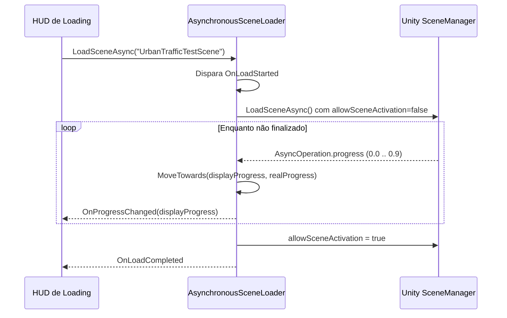

# SYS_GAME_LOADING — Sistema de Carregamento Assíncrono Real

**Data:** 23/11/2026  
**Status:** Implementado e Verificado  
**Fase de Origem:** Fase 5.8 (Transformação em Jogo Independente)

---

## 1. Visão Geral

O `AsynchronousSceneLoader` é o componente central para transições fluidas entre cenas (Menu Principal, Garagem, Cidade Urbana). Ele gerencia o carregamento assíncrono real via Unity `SceneManager.LoadSceneAsync`, convertendo o ciclo não-linear nativo da engine em uma barra de progresso suave e amigável ao usuário.

---

## 2. Normalização e Interpolação de Progresso

O ciclo nativo do Unity reporta o progresso de 0.0 a 0.9 enquanto aloca recursos e 0.9 a 1.0 na ativação final. O componente normaliza a faixa operacional:

$$\text{Progresso Real} = \text{clamp01}\left(\frac{\text{AsyncOperation.progress}}{0.9}\right)$$

### Características
- **Tempo Mínimo de Exibição (`minimumLoadingTime = 0.5s`):** Previne flashes indesejados na tela em hardware rápido.
- **Interpolação Suave (`Mathf.MoveTowards`):** Garante animação orgânica da barra de loading mesmo se o carregamento em disco ocorrer em saltos.

---

## 3. Rastreabilidade de Assets e GUIDs

- **Script:** `Assets/Scripts/Core/AsynchronousSceneLoader.cs` (`100000000000000000000000000000a9`)
- **GameObject na Cena:** Integrado em `ReryCity_GameManager` (`fileID: 1184` em `UrbanTrafficTestScene.unity`).
