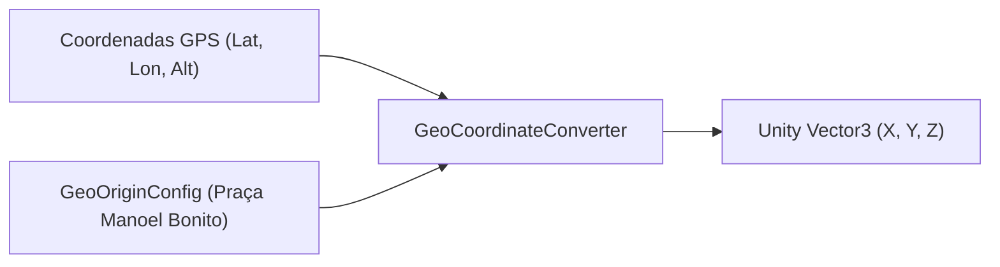

# SYS_GEOGRAPHIC_COORDINATES — Sistema de Conversão e Projeção Geográfica

**Data:** 23/11/2026  
**Status:** Implementado e Verificado  
**Fase de Origem:** Fase 5.9 (Construção da Cidade Real de Araguari)

---

## 1. Visão Geral

O sistema geográfico provê uma conversão matemática rigorosa entre coordenadas angulares da Terra (WGS84 Latitude/Longitude) e coordenadas métricas locais do Unity (X, Y, Z), mantendo precisão submilimétrica sem causar instabilidades de física computacional por valores elevados de ponto flutuante (`float`).

---

## 2. Modelo Matemático da Projeção Planar Local

A projeção adota o modelo da Terra esferoidal WGS84 com raio médio $R = 6.378.137\text{ m}$. A Praça Manoel Bonito atua como origem local $(\phi_0, \lambda_0) = (-18.649100^\circ, -48.190300^\circ)$:

### Equações Diretas (Geo $\rightarrow$ World)
$$x = (\lambda - \lambda_0) \cdot \frac{\pi}{180} \cdot R \cdot \cos(\phi_0 \cdot \frac{\pi}{180}) \cdot \text{scale}$$
$$z = (\phi - \phi_0) \cdot \frac{\pi}{180} \cdot R \cdot \text{scale}$$
$$y = (\text{alt} - \text{alt}_0) \cdot \text{scale}$$

### Equações Inversas (World $\rightarrow$ Geo)
$$\phi = \phi_0 + \left(\frac{z}{\text{scale} \cdot R}\right) \cdot \frac{180}{\pi}$$
$$\lambda = \lambda_0 + \left(\frac{x}{\text{scale} \cdot R \cdot \cos(\phi_0 \cdot \frac{\pi}{180})}\right) \cdot \frac{180}{\pi}$$

---

## 3. Rastreabilidade de Assets e GUIDs

- **Script Conversor:** `Assets/Scripts/World/Geography/GeoCoordinateConverter.cs` (`100000000000000000000000000000ac`)
- **Script Config:** `Assets/Scripts/World/Geography/GeoOriginConfig.cs` (`100000000000000000000000000000ad`)
- **Asset Origem:** `Assets/ScriptableObjects/World/GeoOrigin_AraguariCentro.asset` (`200000000000000000000000000000a8`)
