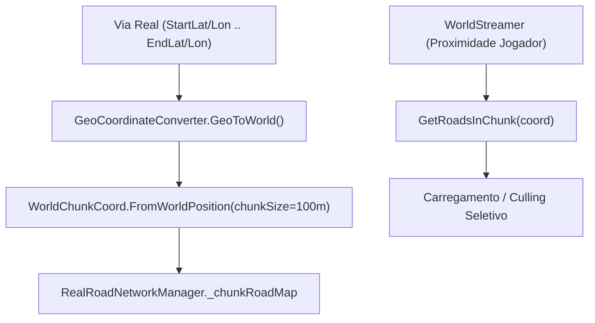

# SYS_MAP_STREAMING_INTEGRATION — Integração Cartográfica ao World Streaming

**Data:** 23/11/2026  
**Status:** Implementado e Verificado  
**Fase de Origem:** Fase 5.9 (Construção da Cidade Real de Araguari)

---

## 1. Visão Geral

Para assegurar desempenho estável em dispositivos móveis Android (especialmente sob os perfis `Economico` e `Equilibrado`), a malha urbana real de Araguari não é mantida integralmente em memória. A malha é fatiada espacialmente em células de streaming gerenciadas em conjunto pelo `WorldStreamer` e pelo `RealRoadNetworkManager`.

---

## 2. Indexação Espacial por Célula de Streaming

### Regras de Operação
- **Indexação Multicélula:** Vias extensas que cruzam fronteiras entre chunks são indexadas em todas as células correspondentes.
- **Budget de Memória Mobile:** Somente os quarteirões e trechos viários dentro do raio ativo (`loadRadiusChunks = 1` a `2`) mantêm colisores PhysX e geometrias ativas.
- **Culling de Longa Distância:** Vias a mais de 220 metros do jogador têm suas instâncias e waypoints descarregados pelo `WorldStreamer`.

---

## 3. Rastreabilidade de Assets e GUIDs

- **Indexador Espacial:** `RealRoadNetworkManager.BuildSpatialIndex()` (`100000000000000000000000000000b0`)
- **Coordenada do Chunk:** `WorldChunkCoord.cs` (`1000000000000000000000000000009c`)
- **Controlador de Streaming:** `WorldStreamer.cs` (`1000000000000000000000000000009e`)
