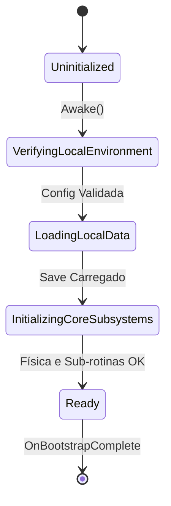

# SYS_OFFLINE_INITIALIZATION — Inicialização Desacoplada e 100% Offline

**Data:** 23/11/2026  
**Status:** Implementado e Verificado  
**Fase de Origem:** Fase 5.8 (Transformação em Jogo Independente)

---

## 1. Visão Geral

O sistema de inicialização de **RERY CITY** foi concebido para eliminar completamente gargalos de rede, verificações de login obrigatórias e chamadas bloqueantes a serviços em nuvem. A inicialização é imediata, segura e totalmente contida localmente no dispositivo móvel.

---

## 2. Ciclo de Vida da Inicialização (`OfflineGameBootstrapper`)

O ciclo opera através de uma máquina de estados finita explícita:

### Estados
1. `Uninitialized`: Estado pré-inicialização.
2. `VerifyingLocalEnvironment`: Valida integridade do `ReryCityIdentityConfig`.
3. `LoadingLocalData`: Invoca `SaveSystem.Instance.LoadGame()` para restaurar dados salvos em disco (moedas, peças, configurações de controle).
4. `InitializingCoreSubsystems`: Estabelece taxa física fixa (`Time.fixedDeltaTime = 0.02f`) e inicializa barramentos de eventos locais.
5. `Ready`: Notifica a cena através do evento `OnBootstrapComplete` que o gameplay pode prosseguir.

---

## 3. Rastreabilidade de Assets e GUIDs

- **Script:** `Assets/Scripts/Core/OfflineGameBootstrapper.cs` (`100000000000000000000000000000a7`)
- **GameObject na Cena:** Integrado em `ReryCity_GameManager` (`fileID: 1182` em `UrbanTrafficTestScene.unity`).
