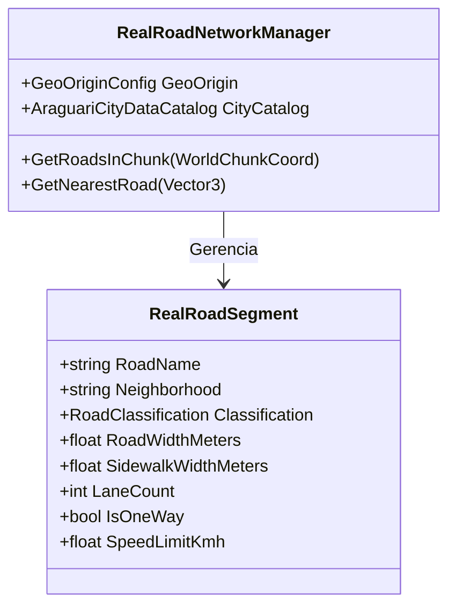

# SYS_REAL_ROAD_NETWORK — Malha Viária Real de Araguari

**Data:** 23/11/2026  
**Status:** Implementado e Verificado  
**Fase de Origem:** Fase 5.9 (Construção da Cidade Real de Araguari)

---

## 1. Visão Geral

O subsistema viário real traduz as artérias, coletoras e ruas centrais de Araguari em segmentos geométricos operáveis (`RealRoadSegment`) e integrados sem duplicações à infraestrutura de navegação viária (`TrafficNavigationManager` e `TrafficWaypointNetwork`).

---

## 2. Hierarquia e Vias Mapeadas

### Principais Vias Reais
1. **Avenida Coronel Theodolino Pereira de Araújo:** Arterial principal de 4 faixas (mão dupla, 16m largura, 60 km/h) margeando o canal central de Araguari.
2. **Avenida Minas Gerais:** Arterial estruturante conectando o Centro à região Norte/Sul (14m largura, 50 km/h).
3. **Avenida Mato Grosso:** Coletora urbana de integração Leste-Oeste (12m largura, 50 km/h).
4. **Rua Marciano Santos:** Via comercial central com tráfego unidirecional (mão única, 10m largura, 40 km/h).
5. **Rua Rui Barbosa:** Eixo comercial de mão única e fluxo de pedestres intenso (10m largura, 40 km/h).
6. **Avenida Batalhão Mauá:** Arterial de ligação com o Bairro Goiás e rodovias (14m largura, 60 km/h).
7. **Rua Brasil Accioly:** Coletora urbana central de apoio ao tráfego coletivo (11m largura, 40 km/h).

---

## 3. Rastreabilidade de Assets e GUIDs

- **Script Segmento:** `Assets/Scripts/World/Geography/RealRoadSegment.cs` (`100000000000000000000000000000af`)
- **Script Gerenciador:** `Assets/Scripts/World/Geography/RealRoadNetworkManager.cs` (`100000000000000000000000000000b0`)
- **GameObject Integrado:** `Araguari_City_Infrastructure` (`fileID: 1190` em `UrbanTrafficTestScene.unity`).
