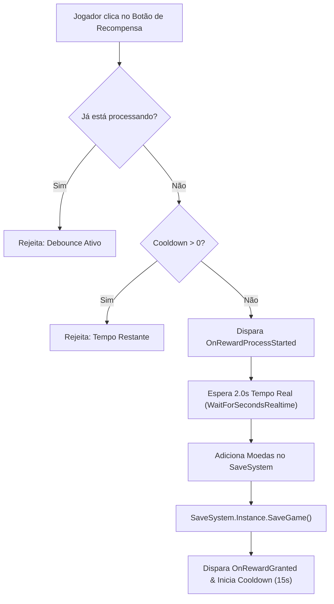

# SYS_SIMULATED_REWARDS — Sistema de Recompensas Simuladas Offline

**Data:** 23/11/2026  
**Status:** Implementado e Verificado  
**Fase de Origem:** Fase 5.8 (Transformação em Jogo Independente)

---

## 1. Visão Geral

O sistema de recompensas simuladas substitui SDKs intrusivos de publicidade (AdMob, UnityAds, etc.) por uma rotina totalmente contida no jogo. O jogador interage com o botão de premiação ("Assistir anúncio para ganhar recompensa"), experimenta uma transição rápida de simulação local (2.0s padrão) e recebe a recompensa diretamente na sua carteira virtual local.

---

## 2. Mecanismos de Proteção e Fluxo Operacional

### Características Técnicas
- **Zero Dependências de Rede:** Nenhuma chamada HTTP, WebRequest ou inicialização de SDK publicitário.
- **Proteção contra Duplo Clique (Debouncing):** `isProcessing = true` bloqueia imediatamente novas chamadas até o encerramento da rotina.
- **Cooldown Configurável:** Intervalo padrão de 15 segundos entre premiações consecutivas para balanceamento da economia local.
- **Persistência Imediata:** A quantia concedida (`baseRewardCoins = 500`) é gravada no arquivo de save do jogador de forma atômica.

---

## 3. Rastreabilidade de Assets e GUIDs

- **Script:** `Assets/Scripts/Monetization/SimulatedRewardManager.cs` (`100000000000000000000000000000a8`)
- **GameObject na Cena:** Integrado em `ReryCity_GameManager` (`fileID: 1183` em `UrbanTrafficTestScene.unity`).
