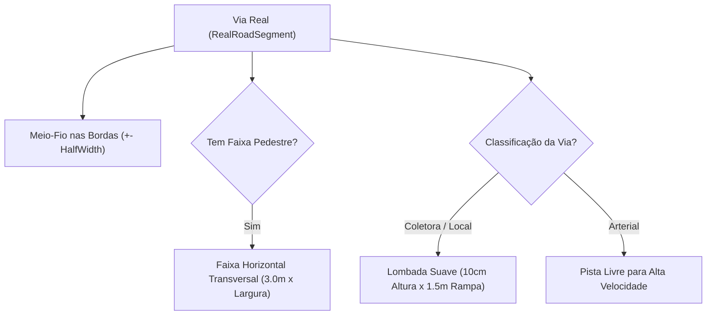

# SYS_STREET_INFRASTRUCTURE — Detalhamento de Vias e Calçadas

**Data:** 23/11/2026  
**Status:** Implementado e Verificado  
**Fase de Origem:** Fase 5.11 (Ambientação Urbana e Detalhamento de Araguari)

---

## 1. Visão Geral

O `StreetInfrastructureDetailer` enriquece as vias reais de Araguari (Fase 5.9) com os elementos físicos e de sinalização horizontal e vertical: meio-fio de concreto, faixas de pedestres, faixas de retenção semafórica e lombadas / redutores de velocidade.

---

## 2. Elementos e Regras de Engenharia Viária

### Parâmetros Físicos
- **Meio-fio e Sarjeta:** Altura de 15cm a 20cm, posicionado na fronteira exata da calçada (`halfWidth = roadWidth / 2`).
- **Lombada Redutora:** Altura calibrada a 10cm com perfil de rampa de 1.5m, permitindo amortecimento realista pela suspensão da motocicleta sem capotamentos ou danos excessivos aos NPCs civis.
- **Faixa de Pedestres:** Pintura branca termoplástica de 3.0m de comprimento nos cruzamentos e em frente a praças e escolas.

---

## 3. Rastreabilidade de Assets e GUIDs

- **Script:** `Assets/Scripts/World/Architecture/StreetInfrastructureDetailer.cs` (`100000000000000000000000000000ba`)
- **GameObject na Cena:** Integrado em `Araguari_City_Detail_Root` (`fileID: 1210` em `UrbanTrafficTestScene.unity`).
