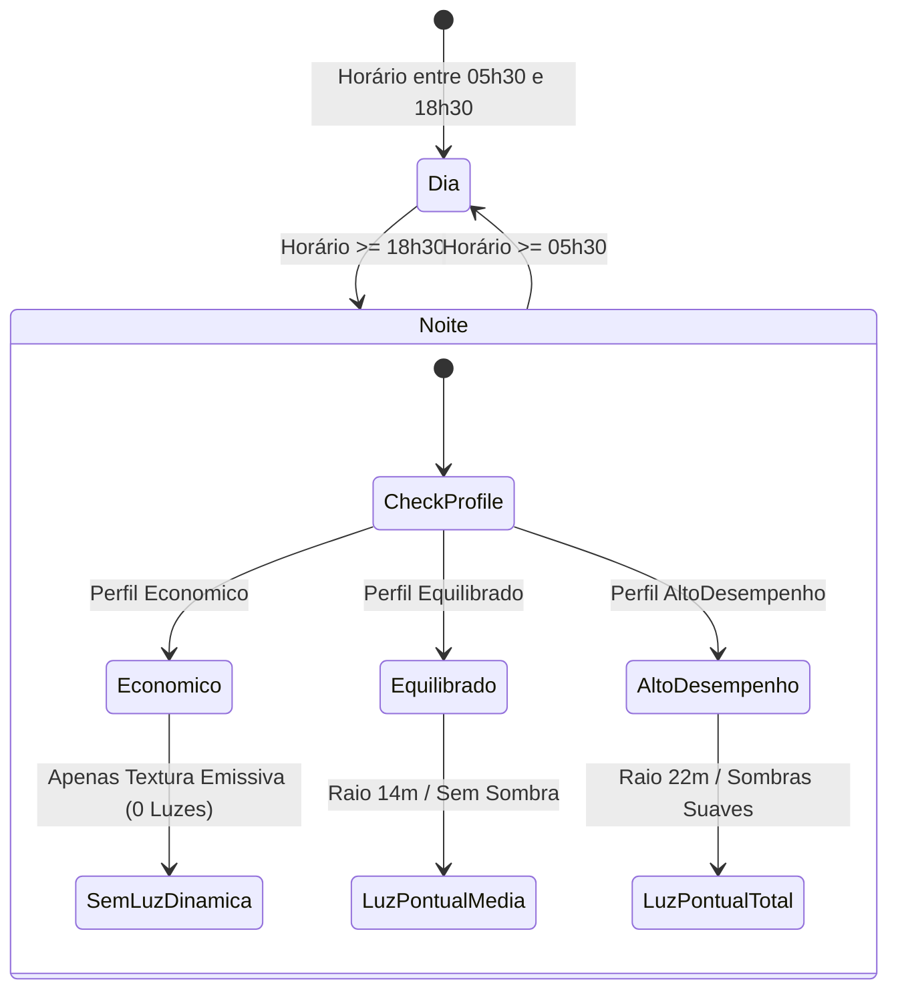

# SYS_URBAN_FURNITURE_LIGHTING — Mobiliário Urbano, Iluminação e Sinalização

**Data:** 23/11/2026  
**Status:** Implementado e Verificado  
**Fase de Origem:** Fase 5.10 (Construção Visual e Arquitetônica de Araguari)

---

## 1. Visão Geral

Este subsistema gere a distribuição de elementos complementares da paisagem urbana de **RERY CITY**: postes de iluminação pública, árvores (ipês e oitis), bancos de praça, placas de trânsito regulamentares, lixeiras e o ciclo de iluminação noturna sincronizado com os perfis de energia mobile.

---

## 2. Iluminação Pública e Perfis de Energia

O `UrbanLightingController` monitora o horário (`timeOfDayHours`) e alterna automaticamente a iluminação com base no perfil ativo:

### Mobiliário Urbano (`UrbanFurnitureManager`)
- **Postes de Iluminação:** Posicionados nas calçadas com espaçamento regular (~30m) ao longo das vias reais.
- **Sinalização Vertical:** Placas de regulamentação (R-1 Parada Obrigatória, R-19 Velocidade Máxima, R-24a Sentido de Circulação).
- **Vegetação Urbana:** Árvores posicionadas em canteiros e calçadas largas sem obstruir o cone de visão de trânsito.

---

## 3. Rastreabilidade de Assets e GUIDs

- **Script Mobiliário:** `Assets/Scripts/World/Architecture/UrbanFurnitureManager.cs` (`100000000000000000000000000000b5`)
- **Script Iluminação:** `Assets/Scripts/World/Architecture/UrbanLightingController.cs` (`100000000000000000000000000000b6`)
- **GameObject na Cena:** Integrado em `Araguari_Visual_Architecture` (`fileID: 1200` em `UrbanTrafficTestScene.unity`).
