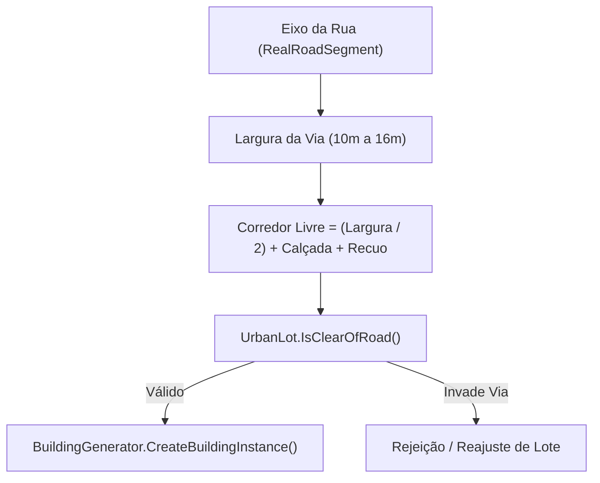

# SYS_URBAN_LOTS_BUILDINGS — Lotes Urbanos e Edifícios Modulares

**Data:** 23/11/2026  
**Status:** Implementado e Verificado  
**Fase de Origem:** Fase 5.10 (Construção Visual e Arquitetônica de Araguari)

---

## 1. Visão Geral

O sistema de lotes e edifícios modulares é responsável por preencher o tecido urbano de **RERY CITY** respeitando estritamente a posição, largura e calçadas das vias reais de Araguari, MG. Ele impede construções sobrepostas às ruas e fornece gabaritos e arquétipos arquitetônicos regionais.

---

## 2. Estrutura de Lote (`UrbanLot`) e Cálculo de Recuo

Cada lote define testada, profundidade, recuo frontal obrigatório (*front setback*) e rotação alinhada à via:

### Categorias Arquitetônicas Regionais
1. `ResidenciaPopular`: Casas geminadas, muros frontais, portões metálicos e telhados cerâmicos.
2. `CasaPadraoMedio`: Residências térreas ou sobrados com garagem e recuo lateral.
3. `ResidenciaModerna`: Arquitetura contemporânea de 2 pavimentos com vidro e platibanda.
4. `EdificioComercial`: Lojas e comércio no térreo com 2 a 5 pavimentos de salas/apartamentos.
5. `PredioResidencial`: Edifícios verticais médios típicos do Centro de Araguari.
6. `OficinaMecanicaGrau`: Oficinas especializadas em preparação de motores, solda de escapamentos e grau.
7. `PostoCombustivel`: Postos urbanos com cobertura metálica e pista de manobra.
8. `MarcoHistoricoPublico`: Arquitetura representativa do Palácio dos Ferroviários e Mercado Municipal.

---

## 3. Rastreabilidade de Assets e GUIDs

- **Script Lote:** `Assets/Scripts/World/Architecture/UrbanLot.cs` (`100000000000000000000000000000b2`)
- **Script Gerador:** `Assets/Scripts/World/Architecture/BuildingGenerator.cs` (`100000000000000000000000000000b3`)
- **Script Catálogo:** `Assets/Scripts/World/Architecture/BuildingArchetypeCatalog.cs` (`100000000000000000000000000000b7`)
- **Asset Padrão:** `Assets/ScriptableObjects/World/BuildingArchetypeCatalog_Default.asset` (`200000000000000000000000000000ab`)
